# PHASE 1 MASTER AUDIT REPORT — CODE CREW

**Project:** Code Crew (Code Review & Debugging AI Agent)  
**Repository:** `https://github.com/charansai12322/codecrew.git`  
**Workspace Path:** `c:\Users\chara\OneDrive\Desktop\projects\codecrew\codecrew`  
**Audit Date:** 2026-10-12  
**Auditor:** Principal AI Engineer & Application Security Reviewer  
**Audit Status:** COMPLETE — VERDICT: **BLOCKED / CONDITIONAL FAIL** (Operational Blockers & Missing Local Environment)

---

## 1. EXECUTIVE SUMMARY

An end-to-end engineering audit of the **Code Crew** repository was conducted. The project was originally prototyped in Google Colab as a 3-agent CrewAI workflow designed to automate code analysis, debugging, and review using Google Gemini LLMs.

### Key Audit Findings:
1. **No Migration Has Taken Place:** The repository contains strictly the raw Google Colab notebook ([codereviewcrew.ipynb](file:///c:/Users/chara/OneDrive/Desktop/projects/codecrew/codecrew/codereviewcrew.ipynb)) and a one-line [README.md](file:///c:/Users/chara/OneDrive/Desktop/projects/codecrew/codecrew/README.md). There are **no Python source files**, no package definitions (`pyproject.toml` or `requirements.txt`), no application entry point (`main.py`), and no existing tests.
2. **Notebook Execution Failed in Colab:** Forensic analysis of the recorded execution outputs inside `codereviewcrew.ipynb` (Cell 13) revealed that the workflow **did not run to completion**. While Agent 1 (`Code_Analyzer`) and Agent 2 (`Senior_Debugger`) successfully executed, Agent 3 (`code_reviewer`) crashed due to an unhandled Google Gemini API `503 UNAVAILABLE` error. The entire crew failed with an unhandled `ServerError`.
3. **Local Execution is Hard-Blocked:** 
   - `crewai` is **not installed** in the local Python 3.12 environment (`ModuleNotFoundError: No module named 'crewai'`).
   - The code imports `google.colab.userdata` to retrieve an obscure secret key `'sec1'`, which crashes immediately outside Google Colab.
   - No API keys (`GEMINI_API_KEY` or `GOOGLE_API_KEY`) are present in the local environment.
   - Top-level `await code_debug_crew.kickoff_async(...)` causes a `SyntaxError` when extracted into standard Python script execution.
4. **Security Vulnerability:** There is **no `.gitignore` file** in the repository. If a developer creates a local `.env` file or saves credentials in the workspace, Git will track and stage them, posing an immediate risk of accidental commit to GitHub.
5. **Static Code & Prompt Defects:** String concatenation in Python without newlines has squashed words and headers together across all agent backstories and task descriptions (e.g., `"{buggy_code}1. Read"`, `"conditionsKeep"`, `"neededYou"`). Furthermore, Agent 2's and Agent 3's backstories are truncated mid-sentence (`"fixed versio"` and `"output the FINAL"`).

---

## 2. REPOSITORY STRUCTURE AND FILE INVENTORY

### Current File Tree
```
c:\Users\chara\OneDrive\Desktop\projects\codecrew\codecrew\
├── .git\                       [Git metadata, clean working tree on origin/main]
├── README.md                   [10 bytes — contains only '# codecrew']
├── codereviewcrew.ipynb        [475,779 bytes — 14-cell Google Colab Jupyter Notebook]
├── audit\                      [Created during Phase 1 audit]
│   ├── PHASE_1_AUDIT_REPORT.md [This master report]
│   ├── FINDINGS.md             [Comprehensive findings ledger]
│   └── TEST_MATRIX.md          [Test execution matrix and verification log]
└── tests\                      [Created during Phase 1 audit]
    ├── __init__.py
    ├── test_notebook_structure_and_syntax.py
    ├── test_environment_and_security.py
    ├── test_reviewed_code_and_fixes.py
    └── test_agent_workflow_contract_mock.py
```

### File Inventory Table

| File Path | Purpose | Actively Used at Runtime? | Dependencies | Risks / Problems | Recommended Action |
|---|---|---|---|---|---|
| [README.md](file:///c:/Users/chara/OneDrive/Desktop/projects/codecrew/codecrew/README.md) | Project title placeholder | No | None | Lacks setup instructions, environment requirements, and usage documentation | Update with comprehensive project documentation and setup guide |
| [codereviewcrew.ipynb](file:///c:/Users/chara/OneDrive/Desktop/projects/codecrew/codecrew/codereviewcrew.ipynb) | Original prototype notebook from Google Colab | Yes (sole existing codebase) | `crewai`, `google.colab`, `google-genai` | Top-level `await`, Colab imports, string concatenation bugs, missing context wiring, no error handling | Preserve as original reference; migrate cleanly into modular Python packages |
| `.gitignore` | Ignore list for Git tracking | Missing | N/A | **High Security Risk**: Secrets in `.env` or local logs can be accidentally committed to GitHub | Create comprehensive `.gitignore` immediately |
| `requirements.txt` / `pyproject.toml` | Dependency declaration | Missing | N/A | Impossible to reproduce environment deterministically; local installation fails | Create pinned dependency manifest |
| `src/` (Source Modules) | Python application code | Missing | N/A | No CLI, API, or reusable modules exist | Construct clean architecture in Phase 2 |

---

## 3. ORIGINAL NOTEBOOK VERSUS MIGRATED IMPLEMENTATION

### Migration Status
**Zero percent migrated.** No extraction into `.py` files had been performed prior to this audit. 

### Notebook Content Analysis (Cell by Cell)

| Cell # | Type | Contents / Purpose | Runtime Viability Outside Colab | Defects Discovered |
|---|---|---|---|---|
| **00** | Markdown | Colab badge link (`Open In Colab`) | Informational | Hardcoded GitHub repository link |
| **01** | Code | `!pip install -U crewai` | Fails (Notebook shell magic) | Unpinned `-U` upgrade risks breaking changes |
| **02** | Code | `!pip install "crewai[google-genai]"` | Fails (Notebook shell magic) | Unpinned installation |
| **03** | Code | Imports `Agent`, `LLM`, `userdata`; initializes `Code_Analyzer` | **Fails** (`ModuleNotFoundError: No module named 'google.colab'`) | Non-standard secret `'sec1'`; invalid model string `gemini/gemini-3.5-flash`; prompt string concatenation squashes words |
| **04** | Code | `!pip install -U 'crewai[tools]'` | Fails (Notebook shell magic) | Placed after Agent 1 is initialized; no tools are ever imported or attached |
| **05** | Code | Initializes `Senior_Debugger` Agent | Fails (Depends on Cell 3 `llm`) | Backstory truncated (`"fixed versio"`); prompt string concatenation squashes words |
| **06** | Code | Initializes `code_reviewer` Agent | Fails (Depends on Cell 3 `llm`) | Backstory truncated abruptly (`"output the FINAL"`); prompt string concatenation squashes words |
| **07** | Code | `from crewai import Task` | Fails (No `crewai`) | None |
| **08** | Code | `task_analyze` Task definition | Fails (No `crewai`) | String concatenation squashes instructions (`"{buggy_code}1. Read"`) |
| **09** | Code | `task_fix` Task definition | Fails (No `crewai`) | String concatenation squashes words; no explicit `context=[task_analyze]` |
| **10** | Code | `task_review` Task definition | Fails (No `crewai`) | String concatenation squashes words; missing `context=[task_analyze, task_fix]` |
| **11** | Code | `code_debug_crew = Crew(...)` | Fails (No `crewai`) | No memory, no tools, no callback, no delegation settings |
| **12** | Code | `import asyncio; game_idea = """..."""` | Valid Python | Misleading variable name `game_idea` (holds Python utility code); unused `import asyncio` |
| **13** | Code | `result = await code_debug_crew.kickoff_async(...)` | **Fails** (`SyntaxError: 'await' outside async function`) | Unhandled top-level `await`; unhandled `ServerError` on upstream 503 API error |

---

## 4. ARCHITECTURE AND WORKFLOW RECONSTRUCTION

### System Architecture Diagram (Current vs. Required)

```mermaid
flowchart TD
    subgraph Current_Flawed_Pipeline["Current Implementation (codereviewcrew.ipynb)"]
        A[User Input: game_idea] -->|Unvalidated String| B[Code_Analyzer Agent]
        B -->|Prompt squashed without newlines| C[task_analyze: Bug Report]
        C -->|Implicit sequential context| D[Senior_Debugger Agent]
        D -->|Backstory truncated 'versio'| E[task_fix: Fixed Code]
        E -->|Implicit sequential context ONLY| F[code_reviewer Agent]
        F -->|Prompt cut off 'output the FINAL'| G{LLM API Request}
        G -->|Google 503 UNAVAILABLE| H[CRASH: ServerError Unhandled]
        H -.->|Execution Aborted| I[Result: Never Returned]
    end

    subgraph Target_Robust_Pipeline["Target Production Pipeline"]
        T1[User Code Input] --> T2[Pydantic Input Validation]
        T2 --> T3[Environment & Secret Manager]
        T3 --> T4[Crew Orchestrator]
        T4 --> T5[Agent 1: Code_Analyzer]
        T5 --> T6[task_analyze: Structured Bug Report]
        T6 --> T7[Agent 2: Senior_Debugger with AST Tool]
        T7 --> T8[task_fix: Verified Runnable Code]
        T6 -.->|Explicit Context| T9[Agent 3: code_reviewer]
        T8 -->|Explicit Context| T9
        T9 --> T10{LLM Call with Retry/Fallback}
        T10 -->|Success| T11[Pydantic Structured Output]
        T10 -->|503/Timeout| T12[Exponential Backoff / Fallback LLM]
        T12 --> T11
    end
```



### Component Implementation Classification

| Component | Classification | Detailed Justification |
|---|---|---|
| **Input Validation** | **MISSING** | No type checking, length checks, or sanitization before passing input into prompt templates. |
| **Environment / Config** | **BROKEN** | Hardcoded to `google.colab.userdata` querying secret `'sec1'`. Fails on any standard machine. |
| **LLM Provider Config** | **PARTIALLY IMPLEMENTED** | Uses LiteLLM integration via CrewAI `LLM()`, but specifies non-standard model name `"gemini/gemini-3.5-flash"` without fallback. |
| **Agent 1 (Analyzer)** | **IMPLEMENTED BUT UNVERIFIED** | Prompts defined, but string concatenation squashed instructions. Verified in Colab output, unverified locally. |
| **Agent 2 (Debugger)** | **IMPLEMENTED BUT UNVERIFIED** | Prompts defined, but backstory truncated (`"versio"`). Fixed code was generated in Colab, but cannot run locally. |
| **Agent 3 (Reviewer)** | **BROKEN** | Backstory cut off (`"output the FINAL"`). Upstream 503 error crashed execution in Colab; unverified and failing. |
| **Task Context Wiring** | **PARTIALLY IMPLEMENTED** | Relies on default sequential implicit context. Reviewer does not explicitly receive Task 1's report. |
| **Tool Integration** | **MISSING** | Package installed in Cell 4, but zero tools configured or provided to agents. |
| **Error Handling / Retries**| **MISSING** | No try/catch blocks, no backoff, no circuit breaking, no fallback model. |
| **Execution Entry Point** | **BROKEN** | Top-level `await` cannot run outside interactive Jupyter/IPython kernels. |

---

## 5. PYTHON ENVIRONMENT AND DEPENDENCY AUDIT

### Environment Comparison

| Dimension | Google Colab Environment (Observed) | Local IDE Environment (Active) | Status / Compatibility Gap |
|---|---|---|---|
| **Operating System** | Linux (Ubuntu, x86_64) | Windows 11 / Windows 10 (x86_64) | **Risk**: Line endings (`\r\n`), console encoding (`cp1252` vs UTF-8) |
| **Python Version** | Python 3.13.x | Python 3.12.10 | **Compatible**: Python 3.12 has superior pre-built binary wheel support |
| **`crewai`** | `1.15.27` installed | **Not installed** | **BLOCKER**: `ModuleNotFoundError` |
| **`crewai-tools`** | `1.15.27` installed | **Not installed** | Tool execution blocked |
| **`google-genai`** | `2.29.0` installed | `2.29.0` installed | Available locally |
| **`langchain`** | `0.3.30` installed | `0.3.30` installed | Available locally |
| **`pytest`** | Not installed in notebook | `8.4.2` installed | Available locally; used for audit suite |
| **`google.colab`** | Native Colab module | Not installed | **Incompatible by design**; must be excised from source code |

### Dependency Observations:
- In Google Colab, `crewai 1.15.27` was installed. In the local Windows environment, `crewai` is absent.
- CrewAI on Windows requires packages like `pypika`, `lancedb`, and `chromadb`. Installing `crewai` on Python 3.12 is well-supported, but unpinned `-U` upgrades can trigger breaking changes.
- **Console Encoding Issue:** On Windows PowerShell, default terminal encoding is `cp1252`. Rich/Textual Unicode output (emojis, box drawing characters) printed by CrewAI raises `UnicodeEncodeError` unless `sys.stdout.reconfigure(encoding='utf-8')` or `PYTHONIOENCODING=utf-8` is set.

---

## 6. CONFIGURATION AND SECURITY AUDIT

### Security Findings
1. **Missing `.gitignore` (Finding SEC-01):** The repository has no `.gitignore` file. Local `.env` files, temporary artifacts, and cache directories (`.pytest_cache`, `__pycache__`) are vulnerable to accidental inclusion in Git commits.
2. **Obscure Secret Identifier (Finding SEC-02):** The code attempts `userdata.get('sec1')`. This is not descriptive and breaks conventions (`GEMINI_API_KEY` or `GOOGLE_API_KEY`).
3. **No Hardcoded Secrets Committed:** Thorough regex auditing across all cells, commit history, and metadata confirmed **no real credentials have been committed to GitHub**.

### Configuration Matrix

| Variable | Used By | Required? | Local Availability | Risk Level | Recommended Action |
|---|---|---|---|---|---|
| `sec1` | `codereviewcrew.ipynb` (Cell 3) | Currently Yes | **MISSING** | **HIGH** | Deprecate immediately; replace with `GEMINI_API_KEY`. |
| `GEMINI_API_KEY` | LiteLLM / Gemini SDK | Yes (Target) | **MISSING** | **HIGH** | Read from `.env` via `python-dotenv` with validation. |
| `GOOGLE_API_KEY` | Alternative Google SDK | Optional Fallback | **MISSING** | Low | Accept as fallback alias for `GEMINI_API_KEY`. |
| `GEMINI_MODEL` | LLM Constructor | Recommended | Defaults to hardcoded string | Medium | Make configurable with default `gemini-2.0-flash`. |

---

## 7. AGENT, TASK, TOOL, AND LLM ANALYSIS

### 1. Agent Definitions
- **Code_Analyzer:** Defined with role, goal, and backstory. Backstory suffers from adjacent string literal concatenation without spaces, merging sentences into `...conditionsKeep your analysis clear...`.
- **Senior_Debugger:** Backstory is truncated mid-sentence: `"You always produce a complete, runnable fixed versio"`.
- **code_reviewer:** Backstory ends abruptly: `"Suggest final improvements and output the FINAL"`.

### 2. Task Definitions and Context Passing
- `task_analyze` takes `{buggy_code}`. Prompt concatenation squashes the code template into the first instruction: `"{buggy_code}1. Read and understand..."`.
- `task_fix` depends implicitly on `task_analyze`. It does not explicitly declare `context=[task_analyze]`.
- `task_review` states in its prompt: *"1. Verify each bug from the analysis report is actually fixed"*. However, in CrewAI's sequential process, Task 3 receives only Task 2's output unless `context=[task_analyze, task_fix]` is specified.

### 3. Tool Usage
- `!pip install -U 'crewai[tools]'` is run in Cell 4, but **zero tools are imported or assigned**.
- Agents are asked to *"test mentally"*. Without sandboxed Python execution or AST verification tools, agents are prone to hallucinating test runs.

### 4. LLM Configuration & The 503 Outage
- Model configured as `model="gemini/gemini-3.5-flash"`. This is an unofficial/non-standard identifier.
- In the Colab execution transcript, Google's API returned:
  `503 UNAVAILABLE. {'error': {'code': 503, 'message': 'This model is currently experiencing high demand. Spikes in demand are usually temporary. Please try again later.'}}`
- Tenacity attempted 3 retries in rapid succession without sufficient jitter or fallback, resulting in `ServerError: 503 UNAVAILABLE` and terminating the entire crew workflow.

---

## 8. STATIC CODE ANALYSIS RESULTS

### 1. Python Syntax & AST Compilation
- Standard Python `compile()` passed for Cells 3, 5, 6, 7, 8, 9, 10, 11, and 12.
- Cell 13 failed: `SyntaxError: 'await' outside async function`. Top-level `await` is only valid in IPython/Jupyter interactive sessions.

### 2. AST String Concatenation Flaws
Python parser automatically concatenates adjacent string literals inside parentheses if no comma is present:
`"line1" "line2"` -> `"line1line2"`.
The following 7 concatenation defects were detected by our AST audit test (`test_ast_detect_string_concatenation_flaws`):
1. `conditionsKeep` (Cell 3)
2. `neededYou` (Cell 5)
3. `fixed versio` (Cell 5)
4. `practicesSuggest` (Cell 6)
5. `{buggy_code}1.` (Cell 8)
6. `taskFix` (Cell 9)
7. `task.1.` and `codeYour` (Cell 10)

---

## 9. TEST PLAN AND EXECUTED TEST RESULTS

A dedicated automated audit test suite was created in [tests/](file:///c:/Users/chara/OneDrive/Desktop/projects/codecrew/codecrew/tests) to verify all components safely without modifying the original notebook.

### Automated Test Execution Summary
Command: `pytest -v tests/`  
Exit Status: `1` (2 intentional test failures asserting missing security and dependency items)  
Duration: `0.14s`  
Summary: **26 Passed, 2 Failed, 1 Skipped**

```
tests/test_agent_workflow_contract_mock.py::test_workflow_normal_execution PASSED
tests/test_agent_workflow_contract_mock.py::test_workflow_missing_input_key PASSED
tests/test_agent_workflow_contract_mock.py::test_workflow_invalid_input_type PASSED
tests/test_agent_workflow_contract_mock.py::test_workflow_empty_and_whitespace_input PASSED
tests/test_agent_workflow_contract_mock.py::test_workflow_provider_503_error_propagation PASSED
tests/test_agent_workflow_contract_mock.py::test_workflow_intermediate_task_failure PASSED
tests/test_agent_workflow_contract_mock.py::test_workflow_context_loss_in_sequential_mode PASSED
tests/test_environment_and_security.py::test_gitignore_existence FAILED (Finding SEC-01)
tests/test_environment_and_security.py::test_no_hardcoded_secrets_in_repository PASSED
tests/test_environment_and_security.py::test_environment_variables_configured SKIPPED (Live Keys Missing)
tests/test_environment_and_security.py::test_crewai_installed_in_environment FAILED (Finding DEP-01)
tests/test_environment_and_security.py::test_google_colab_isolated_from_local_code PASSED
tests/test_notebook_structure_and_syntax.py::test_notebook_json_validity PASSED
tests/test_notebook_structure_and_syntax.py::test_notebook_cell_count_and_types PASSED
tests/test_notebook_structure_and_syntax.py::test_identify_pip_magic_commands PASSED
tests/test_notebook_structure_and_syntax.py::test_detect_colab_specific_dependencies PASSED
tests/test_notebook_structure_and_syntax.py::test_cell_code_syntax_and_top_level_await PASSED
tests/test_notebook_structure_and_syntax.py::test_ast_detect_string_concatenation_flaws PASSED
tests/test_notebook_structure_and_syntax.py::test_detect_truncated_prompt_strings PASSED
tests/test_reviewed_code_and_fixes.py::TestOriginalBuggyCodeDefects::test_buggy_calculate_average_index_error PASSED
tests/test_reviewed_code_and_fixes.py::TestOriginalBuggyCodeDefects::test_buggy_calculate_average_zero_division PASSED
tests/test_reviewed_code_and_fixes.py::TestOriginalBuggyCodeDefects::test_buggy_find_max_negative_numbers PASSED
tests/test_reviewed_code_and_fixes.py::TestOriginalBuggyCodeDefects::test_buggy_remove_duplicates_mutation_error PASSED
tests/test_reviewed_code_and_fixes.py::TestSeniorDebuggerFixes::test_fixed_calculate_average_normal PASSED
tests/test_reviewed_code_and_fixes.py::TestSeniorDebuggerFixes::test_fixed_calculate_average_empty PASSED
tests/test_reviewed_code_and_fixes.py::TestSeniorDebuggerFixes::test_fixed_find_max_positive_and_negative PASSED
tests/test_reviewed_code_and_fixes.py::TestSeniorDebuggerFixes::test_fixed_find_max_empty PASSED
tests/test_reviewed_code_and_fixes.py::TestSeniorDebuggerFixes::test_fixed_remove_duplicates_order_and_uniqueness PASSED
tests/test_reviewed_code_and_fixes.py::TestSeniorDebuggerFixes::test_remove_duplicates_complexity_limitation PASSED
```

For the complete mapping, see [audit/TEST_MATRIX.md](file:///c:/Users/chara/OneDrive/Desktop/projects/codecrew/codecrew/audit/TEST_MATRIX.md).

---

## 10. END-TO-END VERIFICATION EVIDENCE

### 1. Verification of the Bugs in the Target Code (Cell 12)
We verified that the bugs targeted by the agents are genuine:
- `calculate_average([3, 7, 2, 8, 2, 7, 4])` threw `IndexError: list index out of range` on `numbers[i + 1]`.
- `calculate_average([])` threw `ZeroDivisionError: division by zero`.
- `find_max([-10, -5, -2, -20])` returned `0` instead of `-2` (flawed `max_val = 0`).
- `remove_duplicates([1, 2, 2, 3, 1, 4, 3, 5])` threw `IndexError: list index out of range` due to modifying `lst` during range iteration.

### 2. Verification of Senior_Debugger's Output (Cell 13)
We extracted `Senior_Debugger`'s output from the Colab execution trace and tested it:
- `calculate_average` fixed: Correctly uses `numbers[i]` and handles empty list -> **Verified**.
- `find_max` fixed: Correctly initializes with `numbers[0]` and handles negative lists and empty list -> **Verified**.
- `remove_duplicates` fixed: Correctly creates `unique_lst` preserving order -> **Verified**.
- Performance finding: Uses `item not in unique_lst` which is O(N²) quadratic time -> **Flagged in Finding PERF-01**.

### 3. Verification of Live Pipeline Execution
- **Result:** **BLOCKED**
- **Reason:** Missing local `crewai` installation, missing `GEMINI_API_KEY` credential in environment, and top-level `await` statement.

---

## 11. PERFORMANCE, RELIABILITY, AND COST RISKS

1. **LLM Calls Per Request:** Exactly 3 sequential model calls per workflow execution (Analyzer -> Debugger -> Reviewer).
2. **Sequential Latency Bottleneck:** Sequential execution takes ~15–30 seconds depending on LLM response times. If any step fails, previous token spend is wasted.
3. **Token Usage Estimation:**
   - Input buggy code: ~200 tokens
   - Analysis report generated: ~600 tokens
   - Fixed code generated: ~800 tokens
   - Review checklist generated: ~800 tokens
   - Total tokens per successful run: ~2,400 to 3,500 tokens.
4. **Estimated Cost (Gemini 2.0 Flash / 1.5 Flash):**
   - At current pricing ($0.10 / 1M input tokens, $0.40 / 1M output tokens), each review run costs approximately **$0.0008 USD (less than a tenth of a cent)**. Very cost-effective.
5. **Reliability Risk:** High spike demand / 503 error vulnerability. Without a fallback model (e.g. falling back to `gemini-1.5-flash` or `gemini-1.5-pro` or an alternative provider), user requests fail completely when Google Gemini experiences transient load spikes.

---

## 12. FINDINGS ORDERED BY SEVERITY

See [audit/FINDINGS.md](file:///c:/Users/chara/OneDrive/Desktop/projects/codecrew/codecrew/audit/FINDINGS.md) for full descriptions, root causes, and reproduction steps.

### HIGH SEVERITY
1. **SEC-01:** Missing `.gitignore` exposes secrets and local state.
2. **SEC-02:** Hard dependency on Colab `userdata` with obscure secret key (`sec1`).
3. **DEP-01:** Core dependency `crewai` is not installed in the local Python environment.
4. **ARCH-01:** Absence of migrated Python application structure (only raw notebook exists).
5. **ARCH-02:** Top-level `await` breaks non-interactive Python script execution (`SyntaxError`).
6. **AGENT-01:** Non-standard / deprecated model identifier (`gemini/gemini-3.5-flash`).
7. **AGENT-02:** Entire pipeline crashes on upstream 503 Service Unavailable without retries or fallback.

### MEDIUM SEVERITY
8. **DEP-02:** Colab magic installation commands scattered across notebook; unused `crewai[tools]` installation.
9. **ARCH-03:** Task context unlinked in sequential review pipeline; Reviewer lacks direct Task 1 context.
10. **CODE-01:** Adjacent string literal concatenation removes spaces and delimiters in agent prompts.
11. **CODE-02:** Truncated agent backstories (`"fixed versio"` and `"output the FINAL"`).
12. **AGENT-03:** Complete absence of sandboxed code execution or AST linting tools.

### LOW SEVERITY
13. **CODE-03:** Misleading variable naming (`game_idea` used for Python utility code).
14. **PERF-01:** Quadratic O(N²) list search in generated `remove_duplicates` function.

---

## 13. RECOMMENDED REMEDIATION PLAN

### Phase Remediation Roadmap

#### P0: Critical Security & Execution Blockers
1. **Create `.gitignore`:** Block `.env`, virtualenvs, cache files, and OS artifacts.
2. **Setup Clean Environment & Dependencies:** Provide `pyproject.toml` / `requirements.txt` with pinned versions (`crewai`, `google-genai`, `python-dotenv`, `pydantic`).
3. **Standardize Secret Configuration:** Switch from `google.colab.userdata` to `python-dotenv` reading `GEMINI_API_KEY`.

#### P1: Core Architecture & Workflow Migration
4. **Extract Modular Python Architecture:**
   - `src/codecrew/config.py`: Environment and LLM provider configuration.
   - `src/codecrew/agents.py`: Clean, non-truncated agent definitions.
   - `src/codecrew/tasks.py`: Properly formatted task prompts with explicit `context=[...]` wiring.
   - `src/codecrew/crew.py`: Crew assembly with error handling and fallback LLM.
   - `src/codecrew/main.py`: CLI and entry point using `asyncio.run()` or synchronous `kickoff()`.
5. **Fix Prompt String Concatenations & Truncations:** Replace squashed strings with multiline markdown strings.
6. **Resolve Model Version:** Switch model string to verified `gemini/gemini-2.0-flash`.

#### P2: Reliability, Error Handling & Tools
7. **Implement 503 Resiliency & Fallback:** Configure CrewAI fallback models and exponential backoff retry policies.
8. **Add AST / Execution Verification Tool:** Equip agents with a local syntax validator tool so they do not rely solely on "mental testing".
9. **Add Input Validation:** Wrap user inputs in a Pydantic model enforcing non-empty strings, size boundaries, and sanitization.

#### P3: Performance & Documentation
10. **Refine Prompt Quality:** Instruct `Senior_Debugger` to prefer idiomatic O(N) algorithms.
11. **Update README & Developer Guides:** Provide comprehensive setup, environment variable guides, and testing instructions.

---

## 14. PRODUCTION-READINESS ASSESSMENT

**Current Production-Readiness Status: 0 / 10 (NOT PRODUCTION READY)**

### Production Deficiencies:
- **Packaging:** No distribution mechanism, wheel, or container exists.
- **Observability:** Logging is limited to CrewAI verbose stdout; no structured JSON logging or tracing.
- **Fault Tolerance:** Any LLM API failure results in unhandled process crash.
- **Security:** Secret management is hardcoded to Google Colab.
- **Portability:** Code cannot run outside a Colab notebook without modification.

---

## 15. EXPLICITLY UNVERIFIED AND BLOCKED ITEMS

The following items could **not be verified** during Phase 1 due to legitimate environment blockers:
1. **Live Gemini API Kickoff:** Blocked due to missing local `crewai` installation and unconfigured `GEMINI_API_KEY`. (Simulated and validated via contractual mocks).
2. **Multi-Agent Delegation:** CrewAI delegation was not enabled in the notebook (`process=Process.sequential` with default agent parameters); autonomous delegation between agents was therefore neither configured nor verifiable.
3. **Performance under High Concurrency:** The notebook runs a single async kickoff; concurrent request handling or queueing cannot be verified until a backend API service is constructed.

---

## 16. FINAL VERDICT & METRICS

### A. Overall Engineering Scores

| Dimension | Score (out of 10) | Evidence & Limitations |
|---|---|---|
| **Code Correctness** | **4 / 10** | Bugs in prompt concatenation, truncated sentences, top-level await syntax error. |
| **Architecture** | **2 / 10** | Monolithic notebook; no modular Python structure or separation of concerns. |
| **Dependency Compatibility** | **2 / 10** | Colab-coupled; unpinned magic installs; core dependency `crewai` missing locally. |
| **Agent Workflow** | **5 / 10** | Good conceptual 3-agent separation; flawed context wiring and missing tools. |
| **Error Handling** | **1 / 10** | Zero error handling; crashes immediately on upstream 503 errors. |
| **Security** | **3 / 10** | No hardcoded keys leaked, but missing `.gitignore` and relies on Colab secret `'sec1'`. |
| **Test Coverage** | **1 / 10** | Zero pre-existing tests. (Phase 1 audit suite added 29 verification checks). |
| **Reliability** | **2 / 10** | Single point of failure at every LLM call; verified crash in Colab execution. |
| **Local Execution Readiness** | **1 / 10** | Inoperable locally without manual intervention and missing package installations. |
| **Production Readiness** | **0 / 10** | Prototype notebook only; not deployable in current state. |

**Composite Engineering Score: 2.1 / 10**

---

### B. Operational Verdict

# **CONDITIONAL FAIL / BLOCKED**

**Justification:** The project has proven conceptual validity in its multi-agent design, and its generated analysis and fixes for buggy code were demonstrated to be high quality in the Colab output. However, critical defects (missing `.gitignore`, missing local `crewai`, Colab-specific secret retrieval, top-level `await` syntax error, and unhandled 503 crash) prevent safe or correct operation on local machines and production environments.

---

### C. Exact Next Step

**The single most important next action is:**
> **Execute Phase 2 Step 1: Create `.gitignore`, establish a clean Python dependency configuration (`requirements.txt`), and migrate the notebook logic into modular Python files under `src/codecrew/` with environment-based secret resolution.**
